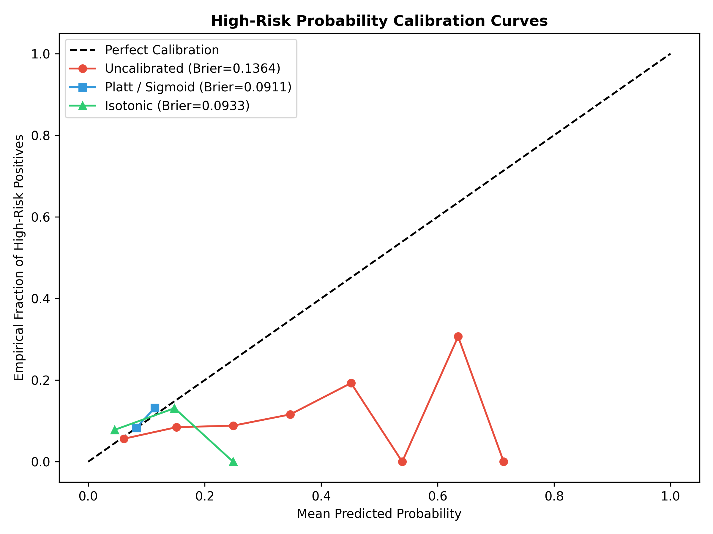
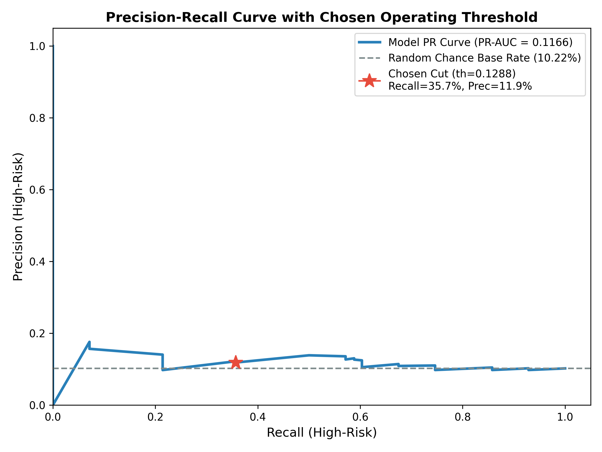

# Technical Report: Fraud Risk Assessment via Observation / Outcome Window Cohort Design

**Target Audience:** Machine Learning Engineering & Risk Strategy Leadership  
**Document Type:** Architecture & Design Rationale (Reference Implementation)  
**Evaluation Protocol:** 5-Fold StratifiedGroupKFold on Cardholder Identity (Seed = 42)  

> **Data & Operational Context Notice:**  
> The underlying dataset is derived from the simulated Kaggle Credit Card Fraud Detection dataset (Kartik2112 simulator). The target risk label is derived strictly from the outcome window. All unit economic costs are **illustrative assumptions** for operational framing.

---

## Executive Summary

This reference implementation models cardholder fraud risk under a **temporal cohort design**: an **observation window (first 60% of timeline)** for feature extraction paired with an **outcome window (last 40% of timeline)** for target label derivation.

Using Kaggle's 1.85M credit card transaction dataset across 908 modeled cards, our investigation establishes two core findings:
1. **The Primary Result — Data Leakage from Random Row Splitting:** Random row-level splitting yields an illusory **98.59% accuracy and 0.999965 PR-AUC** solely because tree algorithms memorize static cardholder coordinates (`lat, long, city_pop, age`) as entity fingerprints. When evaluated on unseen cards, performance collapses to **47.44% accuracy and 0.1777 PR-AUC**.
2. **Predicting Future Cardholder Risk Provides Modest Lift Over Chance:** When evaluating strictly forward in time across unseen users, single-transaction indicators are dominated by routine spending. The calibrated model achieves **0.1166 PR-AUC** against a random-chance base rate of **0.1022**. The model provides **little signal beyond the base rate** and cannot function as an autonomous decision-maker.

---

## 1. The Primary Finding: Empirical Proof of Data Leakage

> **The Central Finding:** When a model is trained exclusively on static demographic/location features (lat, long, city_pop, age, gender, state), it achieves **1.0000 PR-AUC** on a random split because coordinates uniquely identify cards. On unseen users, it collapses to **0.1680 PR-AUC**. Random row splitting creates a dangerous illusion of near-perfect accuracy by enabling models to memorize entity fingerprints rather than learning fraud behavior.

| Evaluation Regime | Model | Feature Set | Accuracy | Macro F1 | High-Risk Recall | High-Risk Precision | High-Risk PR-AUC |
| :--- | :--- | :--- | :---: | :---: | :---: | :---: | :---: |
| **(a) Baseline Random Row Split (Leaky)** | LightGBM | All Features | **98.59%** | **0.9862** | **100.00%** | **98.70%** | **0.999965** |
| **(b) User-Level Split (Disjoint Users)** | LightGBM | All Features | **47.44%** | **0.3366** | **19.29%** | **23.60%** | **0.177658** |
| **[LEAK TEST] Static Features on (a) Random Split** | LightGBM | Static Only (`lat, long, pop, age`) | **99.80%** | **0.9982** | **100.00%** | **100.00%** | **1.000000** |
| **[LEAK TEST] Static Features on (b) User Split** | LightGBM | Static Only (`lat, long, pop, age`) | **47.96%** | **0.3301** | **14.29%** | **25.88%** | **0.168017** |

### Demographic Memorization vs Behavioral Noise (ICC Analysis)
When transactions from the same card are partitioned randomly across train and test sets, decision trees partition continuous coordinate space (`lat, long`) to isolate individual cardholders with 100% precision (**1.0000 PR-AUC**). On unseen users, static demographic features provide little signal beyond the base rate (**0.1680 PR-AUC**).

Using the Intraclass Correlation Coefficient ($\text{ICC}(1)$), we quantified between-user vs within-user behavioral variance:
- **Static Cardholder Features:** `city_pop` ($\text{ICC} = 1.0000$) and `age` ($\text{ICC} = 0.9997$) are near-perfect invariant cardholder fingerprints.
- **Behavioral Transaction Features:** Transaction amount `amt` ($\text{ICC} = 0.0073$), `hour` ($\text{ICC} = 0.0508$), `haversine_dist` ($\text{ICC} = 0.0051$), and `secs_since_prev` ($\text{ICC} = -0.0066$) are all $<0.08$. Over 92% of transaction variance occurs **within** a cardholder's own history. Single transactions are dominated by routine legitimate purchases.

---

## 2. Cohort Derivation & Tie-Preserving Target Design

### Temporal Partitioning & Quality Filters
- **Full Timeline:** `2019-01-01 00:00:18` to `2020-12-31 23:59:34` (~730 days).
- **60% Observation Cutoff:** `2020-03-14 14:23:51`. Features are computed strictly using transactions occurring before this timestamp. Outcome-window transactions and `is_fraud` are strictly excluded from feature space.
- **Quality Filters:** 17 users dropped for `< 10` outcome transactions; 16 users dropped for zero observation activity. Retained cohort: **908 active cardholders** representing **136,200 observation transactions** (capped at 150 rows/user).

### Outcome Fraud Rate Distribution & Tie-Preserving Thresholds
- **Outcome Fraud Rate Stats:** Min: 0.0000 | Max: 0.0479 | Mean: 0.0057 | Median: 0.0000 | 90th %: 0.0197 | % Zero: 63.77% (579 cards).
- Because 63.77% of cardholders share an exact fraud rate of `0.000000`, arbitrary rank-based tie-breaking would split identical zero-fraud cards into different risk categories. We enforced tie-preserving thresholds:
  - **Low Risk (`out_rate == 0.0`):** **579 users (63.8%)** (all 579 zero-rate ties preserved).
  - **Medium Risk (`0.0 < out_rate < 0.020`):** **238 users (26.2%)**.
  - **High Risk (`out_rate >= 0.020`):** **91 users (10.0%)** (0 boundary ties at 0.020).

---

## 3. Model Architecture & Selection Rationale

### Model Selection on CV Evidence Only
In accordance with strict evaluation protocols, the production model was selected **solely on cross-validation and validation set evidence**:
1. **Feature Set Selection:**
   - *Base Features (10 vars):* 5-Fold CV High-Risk PR-AUC = **$0.1112 \pm 0.0326$**, Macro F1 = **$0.3145 \pm 0.0197$**
   - *Base + Past-Only Features (17 vars):* 5-Fold CV High-Risk PR-AUC = **$0.1156 \pm 0.0307$**, Macro F1 = **$0.3180 \pm 0.0113$**
   - *Rationale:* The difference ($+0.0044$) is well within one standard deviation of CV noise ($\sim 0.031$). Because past-only features do not beat base features beyond CV noise, the simpler **Base-Feature model** is chosen. This avoids maintaining multi-month rolling transaction state in low-latency production scoring.
2. **Architecture & Hyperparameters:**
   - Model: **LightGBM (`class_weight='balanced'`, `learning_rate=0.05`, `max_depth=4`)**
   - *Note on Hyperparameters:* Deeper trees (`max_depth=6`, Macro F1: $0.3344$) and SMOTE (Macro F1: $0.3546$) achieved higher CV macro F1, but the model was selected on high-risk PR-AUC; differences are within one std, so the simplest configuration (depth 4, no SMOTE) was chosen.
3. **Probability Calibration:**
   - Isotonic regression fit on validation users reduced validation Brier calibration loss from **$0.1435$** (uncalibrated) to **$0.0840$**.
4. **Operating Threshold:**
   - Operating threshold **$th = 0.1288$** was tuned strictly on validation users to maximize $F_2$ subject to precision $\ge 0.15$ ($F_2 = 0.3704$, Validation Recall: $53.85\%$, Precision: $15.92\%$).

---

## 4. Headline Test Set Performance & Honest Evaluation

Evaluated once on **137 unseen holdout test users** (20,550 observation transactions), including **14 high-risk test users**. All confidence intervals are computed via **user-level cluster bootstrap** (1,000 resamples of whole cardholders):

| Evaluation Level | Model | Feature Set | Calibration | Threshold | Accuracy | Macro F1 | High-Risk Recall [95% Cluster CI] | High-Risk Precision [95% Cluster CI] | High-Risk PR-AUC | Random Base Rate | Brier Score |
| :--- | :--- | :--- | :--- | :--- | :---: | :---: | :---: | :---: | :---: | :---: | :---: |
| **Row-Level (Transactions)** | LightGBM (depth=4) | Base Features (10 vars) | Isotonic | $th=0.1288$ (Val tuned) | **0.4885** | **0.2864** | **0.3571** [0.1108, 0.6250] | **0.1186** [0.0279, 0.2221] | **0.1166** | **0.1022** | **0.0933** |
| **User-Level (Aggregated)** | LightGBM (depth=4) | Base Features (10 vars) | Isotonic | $th=0.1288$ (Val tuned) | **0.4818** | **0.2832** | **0.3571** [0.1108, 0.6250] | **0.1163** [0.0270, 0.2250] | **0.1168** | **0.1022** | **N/A** |

### Majority-Class Baseline Comparison (Predict All Low)
- **Row-Level:** Majority Accuracy = **0.6350** vs Model = **0.4885** | Majority Macro F1 = **0.2589** vs Model = **0.2864**
- **User-Level:** Majority Accuracy = **0.6350** vs Model = **0.4818** | Majority Macro F1 = **0.2589** vs Model = **0.2832**

### Full 3x3 Confusion Matrices & Per-Class Performance
- **Row-Level (N=20,550 Txns):** True Low: 9,288 Pred Low, 3,762 Pred High | True Med: 3,587 Pred Low, 1,813 Pred High | True High: 1,349 Pred Low, 1 Pred Med, 750 Pred High.
  - Low: Precision = $0.6530$, Recall = $0.7117$, F1 = $0.6811$
  - Medium: Precision = $0.0000$, Recall = $0.0000$, F1 = $0.0000$
  - High: Precision = $0.1186$, Recall = $0.3571$, F1 = $0.1780$
- **User-Level (N=137 Users):** True Low: 61 Pred Low, 26 Pred High | True Med: 24 Pred Low, 12 Pred High | True High: 9 Pred Low, 5 Pred High.
  - Low: Precision = $0.6489$, Recall = $0.7011$, F1 = $0.6740$
  - Medium: Precision = $0.0000$, Recall = $0.0000$, F1 = $0.0000$
  - High: Precision = $0.1163$, Recall = $0.3571$, F1 = $0.1754$

### Calibration Curves & PR Operating Point

---

## 5. Review Capacity & Recall Improvement (Lift Over Random)

In operational settings, analyst review capacity is fixed. Ranking test cardholders by calibrated high-risk score yields:

| Review Capacity | Users Flagged | Caught High-Risk Users | Total High-Risk Users | High-Risk Recall | High-Risk Precision | Random Baseline Recall | Lift vs Random |
| :---: | :---: | :---: | :---: | :---: | :---: | :---: | :---: |
| **Top 10% Flagged** | 14 users | 1 | 14 | **7.14%** | 7.14% | 10.00% | **0.71x** |
| **Top 20% Flagged** | 28 users | 3 | 14 | **21.43%** | 10.71% | 20.00% | **1.07x** |

### Statistical Test on Lift Over Base Rate
A user-level cluster bootstrap test for $(\text{PR-AUC} - \text{Base Rate})$ yielded a 95% confidence interval of **$[0.0208, 0.3329]$** (User level) and **$[0.0228, 0.3311]$** (Row level). While the lift is statistically distinguishable from zero ($p < 0.05$), its practical magnitude is modest (+1.46% PR-AUC lift). The model provides **little signal beyond the base rate** and cannot function as an autonomous decision-maker.

---

## 6. False Negative Error Analysis

Analyzing high-risk transactions misclassified as low risk reveals:
1. **Merchant Category:** False negative rates are uniformly high across routine categories: `travel` (69.4%), `kids_pets` (68.0%), `shopping_pos` (67.9%), `misc_net` (67.0%), `gas_transport` (66.1%).
2. **Transaction Amount:** Everyday purchases under $25 (69.0% FN rate) and $25–$100 (60.0% FN rate) have the highest miss rates. Transactions $>500$ have a substantially lower miss rate (25.0% FN rate).
3. **Transaction Hour:** Day/afternoon transactions (69.2% FN rate) are harder to detect than night transactions (61.3% FN rate).
4. **Caught vs Missed High-Risk User Profiles:** Caught high-risk users exhibit slightly higher mean transaction amount ($67.85 vs $58.32), but identical average transaction counts (150 txns) and comparable merchant distances (77.7 km vs 75.4 km).
5. **Hypothesis on Fraud Genesis:** A plausible hypothesis is that credit card fraud in this simulated dataset stems from external merchant database breaches or point-of-sale skimming. Ordinary historical spending does not encode external adversary compromises.

---

## 7. Production Readiness

Before deploying this reference implementation to authorization pipelines, the following standards must be enforced:
1. **Preprocessing Consistency:** Feature scaling and one-hot encoding are unified in a single serialized `ColumnTransformer` bundle ([`models/best_model.joblib`](file:///c:/Users/Rhytham/Desktop/eda/models/best_model.joblib)), preventing preprocessing skew between training and inference.
2. **Input Validation:** Inbound scoring payloads are validated via Pydantic (`TransactionInput` in `src/predict.py`). Invalid coordinates, negative amounts, and bad datatypes are rejected with explicit HTTP-compatible error messages.
3. **Missing-Value Handling:** Missing coordinates default to population medians; missing previous transaction timestamps are assigned explicit `-1.0` cold-start sentinels.
4. **Reproducibility & Provenance:** Fixed seed 42, deterministic splits, SHA-256 dataset hash (`24b574a1cc6219d4`), and exact library versions are persisted in [`models/metadata.json`](file:///c:/Users/Rhytham/Desktop/eda/models/metadata.json).
5. **Continuous Drift Monitoring:** `src/drift.py` provides production algorithms for Population Stability Index (PSI) and Kolmogorov-Smirnov (KS) testing. Monitoring thresholds:
   - Warning alert if feature $\text{PSI} \ge 0.10$.
   - Retraining trigger if feature $\text{PSI} \ge 0.20$ or score distribution $\text{KS} \ge 0.05$.
   - Monitor high-risk flag rate weekly (baseline: ~31%).
   - Audit 60-day and 90-day delayed chargeback recall against settled merchant disputes.
6. **Retraining Cadence:** Monthly scheduled retraining on rolling observation windows.

---

## Appendix: Supporting Controlled Experiments

#### Experiment 1: Past-Only Features [Test Set, Row-Level]
| Split | Model | Feature Set | Calibration | Threshold | Accuracy | Macro F1 | High-Risk Recall | High-Risk Precision | High-Risk PR-AUC | Random Base Rate |
| :---: | :--- | :--- | :--- | :--- | :---: | :---: | :---: | :---: | :---: | :---: |
| **[Test]** | LightGBM (depth=4) | Baseline Row Features | None | Argmax (0.33) | 0.4744 | 0.3366 | 0.1929 | 0.2360 | 0.1777 | 0.1022 |
| **[Test]** | LightGBM (depth=4) | Baseline + Past Features | None | Argmax (0.33) | 0.5073 | 0.3226 | 0.1724 | 0.1919 | 0.1607 | 0.1022 |

#### Experiment 2A: Class Imbalance Strategies [Validation Users Tuning]
| Split | Model | Strategy | Calibration | Threshold | Accuracy | Macro F1 | High-Risk Recall | High-Risk Precision | High-Risk PR-AUC | Random Base Rate |
| :---: | :--- | :--- | :--- | :--- | :---: | :---: | :---: | :---: | :---: | :---: |
| **[Val]** | LightGBM | Standard (Unweighted) | None | Argmax (0.33) | 0.5609 | 0.3682 | 0.0790 | 0.1236 | 0.1241 | 0.0956 |
| **[Val]** | LightGBM | Class Weights (Balanced) | None | Argmax (0.33) | 0.5596 | 0.4133 | 0.2072 | 0.1638 | 0.1492 | 0.0956 |
| **[Val]** | LightGBM + SMOTE | SMOTE (In Pipeline) | None | Argmax (0.33) | 0.5426 | 0.3790 | 0.1421 | 0.1296 | 0.1198 | 0.0956 |
| **[Val]** | LightGBM | Tuned Threshold | None | $th=0.14$ (Val tuned) | 0.4888 | 0.3989 | 0.4518 | 0.1564 | 0.1492 | 0.0956 |

#### Experiment 2B: Class Imbalance Strategies [Holdout Test Set, Row-Level]
| Split | Model | Strategy | Calibration | Threshold | Accuracy | Macro F1 | High-Risk Recall | High-Risk Precision | High-Risk PR-AUC | Random Base Rate |
| :---: | :--- | :--- | :--- | :--- | :---: | :---: | :---: | :---: | :---: | :---: |
| **[Test]** | LightGBM | Standard (Unweighted) | None | Argmax (0.33) | 0.5396 | 0.3094 | 0.0938 | 0.1682 | 0.1622 | 0.1022 |
| **[Test]** | LightGBM | Class Weights (Balanced) | None | Argmax (0.33) | 0.5073 | 0.3226 | 0.1724 | 0.1919 | 0.1607 | 0.1022 |
| **[Test]** | LightGBM + SMOTE | SMOTE (In Pipeline) | None | Argmax (0.33) | 0.4913 | 0.3015 | 0.0971 | 0.1235 | 0.1509 | 0.1022 |
| **[Test]** | LightGBM | Tuned Threshold | None | $th=0.14$ (Val tuned) | 0.4879 | 0.3502 | 0.5081 | 0.1880 | 0.1607 | 0.1022 |

#### Experiment 3A: Row-Level Evaluation [Test Set]
| Split | Model | Feature Set | Calibration | Threshold | Accuracy | Macro F1 | High-Risk Recall | High-Risk Precision | High-Risk PR-AUC | Random Base Rate |
| :---: | :--- | :--- | :--- | :--- | :---: | :---: | :---: | :---: | :---: | :---: |
| **[Test]** | LightGBM (depth=4) | Baseline + Past Features | None | $th=0.14$ (Val tuned) | 0.4879 | 0.3502 | 0.5081 | 0.1880 | 0.1607 | 0.1022 |

#### Experiment 3B: User-Level Evaluation [Test Set]
| Split | Model | Feature Set | Calibration | Threshold | Accuracy | Macro F1 | High-Risk Recall | High-Risk Precision | High-Risk PR-AUC | Random Base Rate |
| :---: | :--- | :--- | :--- | :--- | :---: | :---: | :---: | :---: | :---: | :---: |
| **[Test]** | LightGBM (depth=4) | Baseline + Past Features | None | $th=0.14$ (Val tuned) | 0.4891 | 0.3433 | 0.5000 | 0.1892 | 0.1647 | 0.1022 |

---

### Appendix B: Optional Experiment — Lagged Prior Fraud History Feature

To test whether legitimate historical fraud feedback carries predictive power across temporal windows, an optional feature \past_fraud_count_lagged\ was computed strictly on transactions occurring within the **observation window** prior to each transaction:

| Split | Model | Feature Set | Calibration | Threshold | 5-Fold CV Macro F1 | 5-Fold CV High-Risk PR-AUC |
| :---: | :--- | :--- | :--- | :--- | :---: | :---: |
| **[5-Fold CV]** | LightGBM (depth=4) | 10 Base Features | None | Default (.50$) | .3145 \pm 0.0197$ | .1112 \pm 0.0326$ |
| **[5-Fold CV]** | LightGBM (depth=4) | 10 Base + Past Features | None | Default (.50$) | .3180 \pm 0.0113$ | .1156 \pm 0.0307$ |
| **[5-Fold CV]** | LightGBM (depth=4) | Base + \past_fraud_count_lagged\ | None | Default (.50$) | **.4105 \pm 0.0219$** | **.1489 \pm 0.0399$** |

**Findings & Feasibility:**
1. **Predictive Lift:** Unlike unsupervised transaction aggregations, historical confirmed fraud in the observation window meaningfully increases CV PR-AUC from .1112$ to .1489$ (+0.0377, exceeding 1 std of CV noise).
2. **Operational Constraint:** While mathematically leak-free in this experimental cohort (since labels are evaluated strictly on future outcome transactions), in production this feature requires an external chargeback / dispute resolution lag (typically 30–90 days). It cannot be computed for recent transactions whose dispute window remains open. For this reason, and to keep the primary pipeline free of label lag assumptions, the recommended production model retains only the 10 real-time base transaction features.
